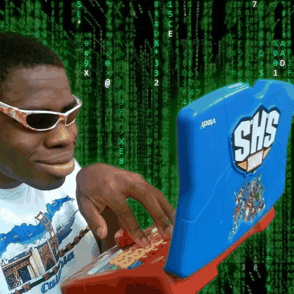

<h1 align="center">Oi, eu sou o Gabriel 👋</h1>
<h3 align="center">Dev full stack em formação · criando SaaS com Next.js, React e Supabase</h3>

- 🚀 Criador do **[Oraklo](https://github.com/gabrieldasruas/oraklo)** e da **[Codexa](https://github.com/gabrieldasruas/codexa)**
- 🔎 Oraklo: prospecção B2B com busca de empresas por mapa, pipeline, e-mail, WhatsApp e IA · [ver no ar](https://oraklo.vercel.app)
- 🌐 Codexa: vitrine de modelos de sites para empresas
- 🌱 Aperfeiçoando minhas skills em front end  

 

### 🛠️ Tecnologias

  

### 📂 Outros projetos

| Projeto | O que é | Tecnologias |
|---|---|---|
| [codexa](https://github.com/gabrieldasruas/codexa) | CODEX Tecnologia: vitrine de modelos de sites para empresas | Next.js · TypeScript · Tailwind |
| [transporteslog](https://github.com/gabrieldasruas/transporteslog) | TransLogística: site institucional de transportadora | HTML · CSS · JS |
| [Starbucks](https://github.com/gabrieldasruas/Starbucks) | Landing page Starbucks Happy Hour (estudo) | HTML · CSS |
| [Projetos_Pessoais](https://github.com/gabrieldasruas/Projetos_Pessoais) | Portfólio pessoal: primeiros estudos | HTML · CSS |
